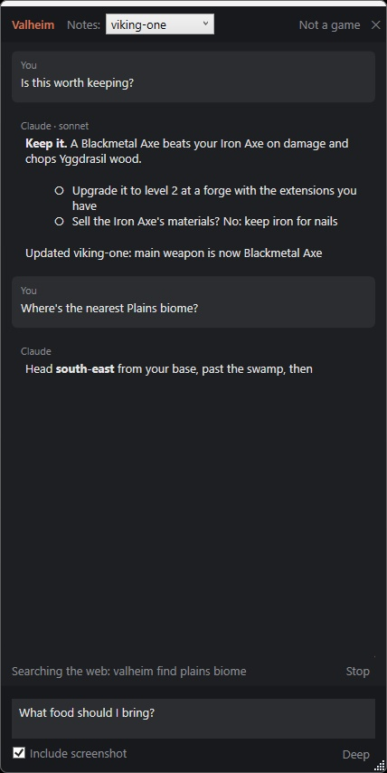

# Claude Game Helper

A side panel for Windows that answers questions about the game you're playing. Press a hotkey, and it
takes a screenshot of your game and asks Claude what you're looking at and what to do. Or type any
question. Claude searches the web so answers match the game as it is today, and it keeps notes on your
character or save between sessions.



## What you need

- Windows 10 or 11.
- [Claude Code](https://docs.claude.com/en/docs/claude-code/overview) installed and signed in to your own
  Claude account. The helper runs Claude Code for you, so questions count toward your Claude plan's usage.
- Games running in **windowed** or **borderless window** mode. In exclusive fullscreen, the panel can't
  appear over the game; put it on a second monitor instead.

## Install

1. Download `ClaudeGameHelper-win-Setup.exe` from the [latest release](../../releases/latest).
2. Run it. Windows may say **"Windows protected your PC"** because the installer isn't code-signed yet: click
   **More info**, then **Run anyway**. No admin rights are needed.
3. The helper starts and puts an orange **C** in the system tray (you may need the **^** arrow to see it).

It starts with Windows from then on. To turn that off, right-click the tray icon and uncheck **Start with
Windows**. Updates download by themselves and install the next time the helper starts.

## Use it

| Hotkey | What it does |
|---|---|
| **Ctrl+Shift+F1** | Screenshot the game and ask "what am I looking at, and what should I do?" |
| **Ctrl+Shift+F2** | Open the question box (with a screenshot attached). Enter sends; Esc hides. |
| **Ctrl+Shift+F3** | Show or hide the panel. |

- **Several screens in one question:** press Ctrl+Shift+F2, then Ctrl+Shift+F1 on each screen you want to
  include (stats, skills, gear), then type your question and press Enter.
- **Deep:** turn it on in the question box for planning questions; it uses Claude's stronger model.
- The panel never takes keyboard focus from your game unless you're typing a question.

## Any game

The first time you use a hotkey in a game, the helper sets that game up on its own, named after the
game's window. Claude is told which game it is and keeps notes for it (for example, one file per
character). Fallout 76 comes with hand-tuned instructions.

If the helper picks up a program that isn't a game (a launcher, say), click **Not a game** in the panel's
header. It won't ask again, and nothing is deleted.

To tune how Claude helps with a particular game, put your own `CLAUDE.md` in that game's folder (see
below). The helper uses yours instead of its built-in instructions, and updates never overwrite it.

## Where your stuff lives

- **Notes, screenshots, and conversations:** `Documents\Claude Game Helper\<game>\`
- **Logs** (handy if something goes wrong): `Documents\Claude Game Helper\logs\`
- **Settings** (hotkeys, models): `%APPDATA%\ClaudeGameHelper\settings.json`; open it from the tray menu.
  Changes take effect the next time the helper starts.

## Is it safe for my game account?

The helper only looks at the screen, using the same Windows screen capture that recording apps use. It
never reads game memory, never injects anything into the game, and never sends keystrokes or mouse input
to it. Claude is told never to suggest exploits.

Claude also runs with tight limits: it can search the web, look at your screenshots, and read the game's
settings files, but it can only write its own notes files. It can't run commands on your PC.

## Building from source

Requires the .NET 10 SDK.

```powershell
dotnet test                            # run the tests
./release.ps1 -Version 0.2.1           # build releases\ClaudeGameHelper-win-Setup.exe
./release.ps1 -Version 0.2.1 -Publish  # build and publish a GitHub release (needs `gh auth login`)
```

## License

[MIT](LICENSE)
